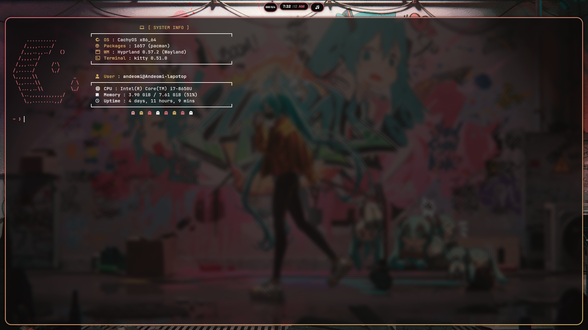
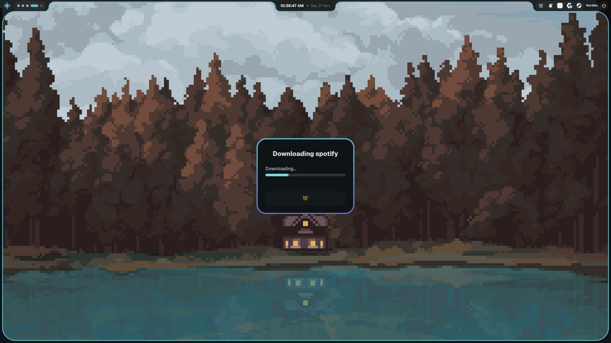
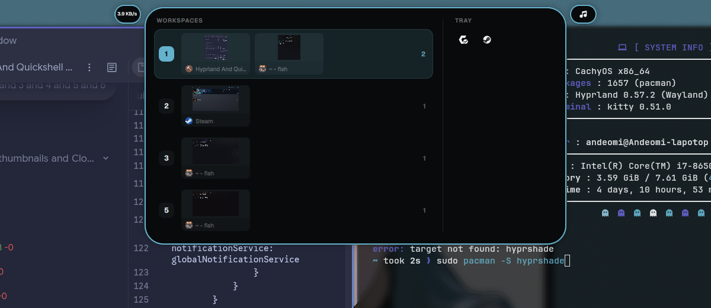
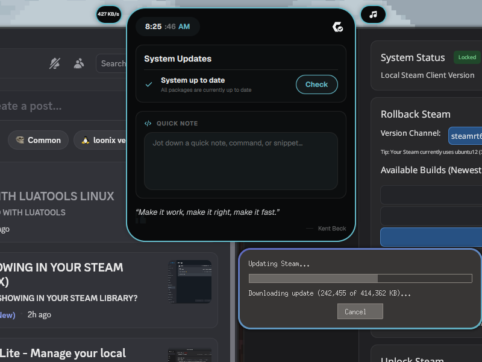

# Veyra Dotfiles

A wallpaper-driven **Hyprland 0.57+ (Lua)** and **Quickshell** desktop rice (**Veyra**) for Arch Linux / CachyOS, built upon and customized from [**t4lentles5/minflair**](https://github.com/t4lentles5/minflair).

<p align="center">
  
</p>

## Showcase

| Convex Mode (Connected Bar & Bezel Frame) | Live Island Overview (`SUPER + Tab`) |
| :---: | :---: |
|  |  |

<details>
<summary><b>More Previews (Dashboard & Quick-Note Pad)</b></summary>
<br />
<p align="center">
  
</p>
</details>

## Highlights

- **Adaptive Wallpaper Palette**: Extracts dark/light Material You + accent palettes from your active wallpaper (`awww` + `matugen`) via `apply_theme.py` and updates Hyprland (`colors.local.lua` + `hyprtoolkit.conf`), Quickshell tokens & themed SVG icons, Kitty (`theme.conf` + live reload), Fastfetch (`noctalia.jsonc` + ANSI slots), Foot, Starship (`[palettes.quickshell]`), GTK 3/4, Qt (`qt5ct`/`qt6ct`/`kdeglobals`), Btop, LazyGit, Neovim, Spicetify, and Discord/Vesktop (`veyra.theme.css`).
- **Dynamic Island, Convex & Gaming Bar Styles**:
  - **Rotating Two-Color Gradient Borders** (`Theme.accent` ↔ `Theme.accentComplementary`) on Island capsules, expanded Island popups, and the connected Convex bar + screen frame bezel.
  - Live **Island Overview** (`SUPER + Tab`) with `ScreencopyView` window thumbnails per workspace and an inline system tray (supported in both Island and Convex bar styles).
  - **Focus / Pomodoro Timer** (`25m Focus`, `5m Break`, `15m Long`) inside the Island Clock popup.
  - **Quick-Note Pad & Task List** inside the Dashboard (`CTRL + ALT + D`) with auto-save and one-click copy.
  - **Auto-Hide on Gaming Workspace** (`SUPER + G`).
  - Cursor-origin `awww` wallpaper grow transitions, album art media toasts, and keyboard-layout OSDs.
- **Native GLSL ES 3.00 Screen Shaders**: Toggle/cycle `Vibrance`, `Film Grain`, `CRT`, and `Warm` shaders via `SUPER + ALT + H` or Veyra Settings.
- **Compositor Customization Studio** (`SUPER + Z`): Live controls for **Accent Window Glow** (toggle, primary/secondary accent color, opacity, range, falloff), **Hyprland Animations** (curve, window open/close style, workspace transition style, speed scaling, rotating border spin, layer pop-ins), and **Lock Screen** clock layouts & font weights.
- **Laptop Eco & Idle Rules**: Automatic battery vs AC rules to drop blur passes / pause border spin / gently dim on unplug and restore full visuals on AC, plus `hypridle` screen dimming and battery-aware suspend.
- **UI Sound Effects**: Subtle stereo audio cues on screenshots, recording start/stop, charger plug/unplug, lock/unlock, and Pomodoro completion (`sound-theme-freedesktop` / Ocean).
- **Safe Installer & Health Doctor**: Automated idempotent installer (`./install.sh`) with timestamped backups and local-config preservation, paired with a comprehensive connectivity & runtime doctor (`./doctor.sh`).

---

## Quick Start

```bash
git clone https://github.com/An-deomi/veyra-dotfiles.git ~/dotfiles
cd ~/dotfiles

# Preview everything install.sh will do (zero filesystem changes)
./install.sh --dry-run

# Install dependencies (Arch / CachyOS + AUR) and deploy Veyra configs
./install.sh --deps

# Or deploy configs only (no sudo / package installation)
./install.sh --no-deps

# Run health, wiring & daemon diagnostics anytime
./doctor.sh
```

### Installer Options (`./install.sh`)

| Flag | Description |
|---|---|
| `-n`, `--dry-run` | Preview backups, file deployments, template seeding, and symlinks without modifying files or running `sudo` |
| `-y`, `--yes` | Non-interactive mode (auto-accept confirmation prompts) |
| `--deps` | Install missing Arch/CachyOS packages via `pacman` and AUR packages (`otf-geist`, `bibata-cursor-theme-bin`, etc.) via `paru` or `yay` |
| `--no-deps` | Skip system package checks/installation completely (never invokes `sudo`) |
| `--backup-dir <dir>` | Custom backup destination (defaults to `~/.local/share/veyra-backups/<timestamp>/`) |
| `--no-color` | Disable ANSI colors |
| `-h`, `--help` | Show full usage and preserved user-local file list |

**What `./install.sh` guarantees:**
- Automatically backs up any existing `~/.config/{hypr,quickshell,kitty,fastfetch,starship,fish}`, `~/.config/starship.toml`, and `~/.local/share/veyra` before touching anything.
- Never overwrites your machine-local overrides on re-install (`~/.config/hypr/{userprefs.local.lua,monitors.lua,veyra-settings.lua,keybinds_custom.lua,windowrules.local.lua}`, `~/.config/quickshell/hotspot_backend.json`, `~/.local/share/veyra/todo.json`), while seeding `.example` defaults on a fresh install.
- Links `~/.config/starship.toml -> starship/starship.toml`, initializes your dynamic palette via `apply_theme.py` (even in headless/TTY installs), and verifies the setup with `./doctor.sh`.

### Rice Health Doctor (`./doctor.sh`)

`./doctor.sh` inspects 40+ checkpoints across your setup and prints actionable remediation commands:
- **Environment & Session**: Arch/CachyOS detection, Wayland session status, Hyprland `>= 0.57` + native Lua `configerrors` check.
- **Binaries**: Core (`Hyprland`/`hyprctl`, `quickshell`, `awww`, `matugen`, `python3`, `jq`), Rice apps (`kitty`, `fastfetch`, `starship`, `fish`), and Desktop utilities (`grim`, `slurp`, `wl-clipboard`, `cliphist`, `brightnessctl`, `hypridle`, `hyprsunset`, `hyprpicker`, `pw-play`, `wpctl`, `cava`, `nmcli`, `bluetoothctl`).
- **Fonts & Cursors**: `Geist`, `JetBrainsMono Nerd Font`, and `Bibata-Modern-Ice`.
- **Config, Wiring & Theme Pipeline**: Lua modules, GLSL shaders, `shell.qml`, Starship symlink, Kitty/Fastfetch configs, custom templates, UI sound assets, foreign `/home/<user>` path leaks, `apply_theme.py` syntax compilation, and generated palette files.
- **Live Daemons**: `Hyprland`, `quickshell`, `awww-daemon`, `hypridle`, `cliphist` watcher, and `pipewire` (gracefully skipped in TTY/CI).

Supports `--help`, `--no-color`, `--strict` (warnings exit `1`), and `--json` (machine-readable report).

---

## Dependencies

- **Core:** `hyprland` (`>= 0.57` with native Lua config), `quickshell`, `awww`, `matugen`, `python`, `jq`
- **Rice Apps:** `kitty`, `fastfetch`, `starship`, `fish`
- **Desktop Utilities:** `grim`, `slurp`, `wl-clipboard`, `cliphist`, `brightnessctl`, `hypridle`, `hyprsunset`, `hyprpicker`, `pipewire` (`pw-play`), `wireplumber` (`wpctl`), `sound-theme-freedesktop`, `cava`, `networkmanager` (`nmcli`), `bluez-utils` (`bluetoothctl`)
- **Fonts & Cursors:** `ttf-jetbrains-mono-nerd`, `otf-geist` (AUR), `bibata-cursor-theme-bin` (AUR)

---

## Keybinds

| Shortcut | Action |
|---|---|
| `SUPER + Space` | App Launcher (`=math`, `:emoji`, `!g`, `!yt`, `!ddg`, `!gh`, `!aw`, `cb`, `>cmd`) |
| `SUPER + Tab` | Live Island Overview (workspace window thumbnails + tray) |
| `SUPER + SHIFT + Tab` | Cycle windows |
| `SUPER + \`` | Toggle dropdown Kitty scratchpad |
| `SUPER + T` / `SUPER + SHIFT + T` | Open Kitty / floating Kitty |
| `SUPER + E` | File manager |
| `SUPER + Return` | Code editor |
| `SUPER + W` | Browser |
| `SUPER + Q` | Close active window |
| `SUPER + F` / `SUPER + D` | Fullscreen / Maximize |
| `SUPER + ALT + Space` | Toggle floating |
| `SUPER + G` | Switch to Gaming workspace (hides top bar) |
| `SUPER + Z` | Veyra Settings |
| `SUPER + K` | Keybinds Manager |
| `SUPER + X` | Control Center |
| `SUPER + V` | Clipboard History |
| `SUPER + A` | Notifications Center |
| `SUPER + SHIFT + W` | Wallpaper Selector |
| `SUPER + ALT + S` / `Print` | Screenshot Widget (`Shift+Print` full screen, `Ctrl+Print` silent capture) |
| `SUPER + ALT + N` | Toggle Night Light (`hyprsunset`) |
| `SUPER + ALT + H` | Cycle GLSL Screen Shader |
| `SUPER + L` | Lock Screen |
| `SUPER + ALT + C` | Power Menu |
| `SUPER + R` | Restart Quickshell |
| `CTRL + ALT + D` | Dashboard (Updates, Quick Note, Quote) |
| `3-finger swipe` (left/right) | Switch workspaces |

---

## Directory Layout

```text
dotfiles/
├── install.sh                 # Safe, idempotent installer (--dry-run, --deps/--no-deps, backups)
├── doctor.sh                  # Rice health, dependency, wiring & live daemon diagnostics
├── .config/
│   ├── hypr/                  # Hyprland 0.57+ Lua modules, animations, GLSL shaders, hypridle
│   │   └── examples/          # Portable templates for userprefs.local.lua, monitors.lua, veyra-settings.lua
│   ├── quickshell/            # Veyra shell (Bar/Island/Convex, Launcher, LockScreen, Settings, Theme engine)
│   ├── kitty/                 # Kitty terminal config + fallback noctalia theme
│   ├── fastfetch/             # Fastfetch layout (dynamically colored from wallpaper)
│   ├── starship/              # Starship prompt config using [palettes.quickshell]
│   ├── starship.toml          # Relative symlink -> starship/starship.toml
│   └── fish/                  # Portable Fish shell config
├── .local/share/veyra/
│   └── custom_templates/      # Default-enabled Discord/Vesktop, Fastfetch, and Foot palette templates
├── assets/screenshots/        # Showcase desktop previews
├── LICENSE
└── README.md
```

---

## Credits

- Based on [**MinFlair**](https://github.com/t4lentles5/minflair) by [**@t4lentles5**](https://github.com/t4lentles5) — thank you for the original modular Hyprland + Quickshell foundation.
- Modified, extended, and maintained as **Veyra** by [**@An-deomi**](https://github.com/An-deomi).

## License

GNU General Public License v3.0 (GPL-3.0) — see [LICENSE](LICENSE), matching upstream [t4lentles5/minflair](https://github.com/t4lentles5/minflair).
